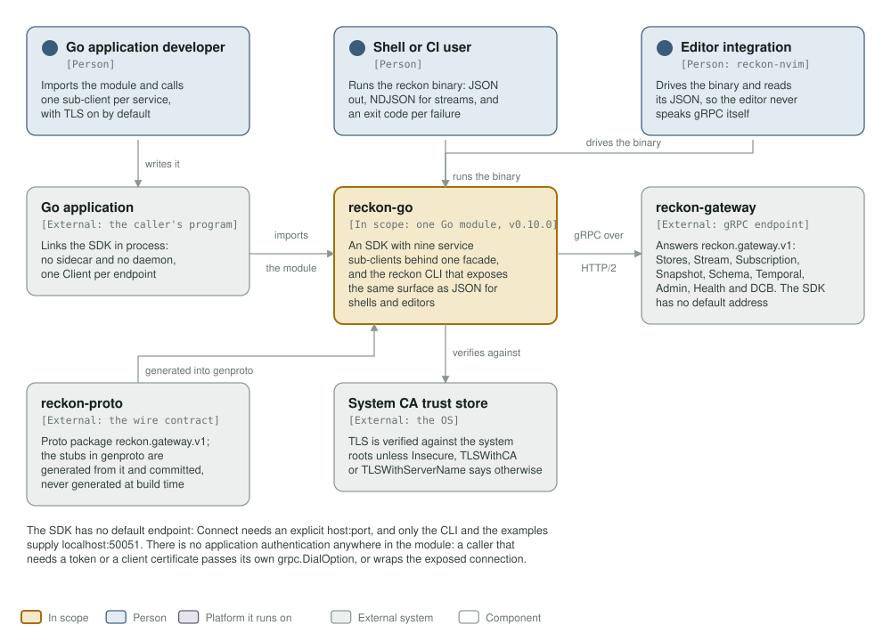
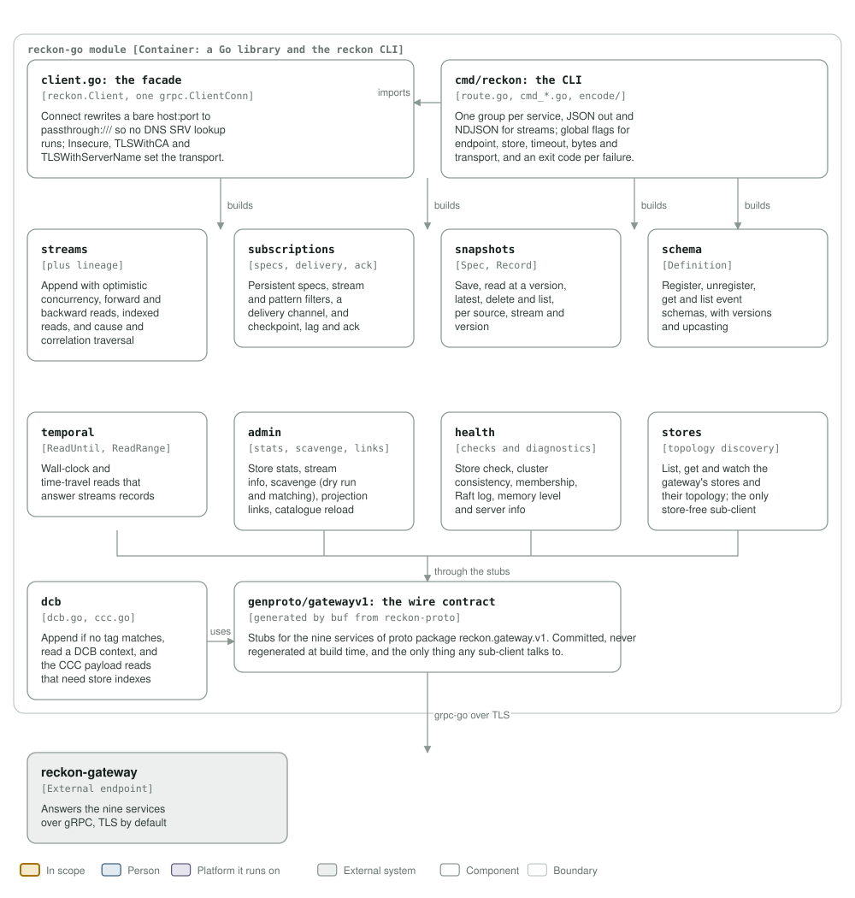

# reckon-go architecture

A C4 model of the module, drawn from the packages in this repository rather than
from a template. `c4_diagrams.py` generates both diagrams; run it after a change
that adds, removes or renames a package:

```
python3 architecture/c4_diagrams.py
rsvg-convert -w 1400 assets/c4-context.svg -o /tmp/c4-context.png   # look at it
```

The `c4 model` workflow fails a commit that drops either file or its link here,
and a diagram that still names a package the module lost is drift.

## Level 1: system context



| Element | What it is | Why it is there |
|---|---|---|
| **reckon-go** | One Go module (v0.10.0): an SDK with nine service sub-clients behind one facade, and the `reckon` CLI | The system this repository builds |
| Go application developer | Person | Imports the module and calls one sub-client per service |
| Shell or CI user | Person | Runs the `reckon` binary: JSON out, NDJSON for streams, an exit code per failure |
| Editor integration | Person, `reckon-nvim` | Drives the binary and reads its JSON, so the editor never speaks gRPC itself |
| Go application | External | Links the SDK in process: no sidecar, no daemon, one `Client` per endpoint |
| reckon-gateway | External | Answers `reckon.gateway.v1`: Stores, Stream, Subscription, Snapshot, Schema, Temporal, Admin, Health and DCB |
| reckon-proto | External | The wire contract; the stubs in `genproto/` are generated from it and committed |
| System CA trust store | External | TLS is verified against it unless `Insecure`, `TLSWithCA` or `TLSWithServerName` says otherwise |

The SDK has no default endpoint: `Connect` needs an explicit `host:port`, and only
the CLI, the probes and the examples supply `localhost:50051`. There is no
application authentication anywhere in the module — a caller that needs a token
or a client certificate passes its own `grpc.DialOption`, or wraps the connection
`Client.Conn()` exposes.

## Level 3: components



| Component | Real packages | Responsibility |
|---|---|---|
| The facade | `client.go`, the nine `*_facade.go` files | Holds the one `grpc.ClientConn`; `Connect`, `Insecure`, `TLSWithCA`, `TLSWithServerName`; builds each sub-client per call |
| The CLI | `cmd/reckon`, `cmd/reckon/encode` | Routes per service group, renders JSON and NDJSON, maps failures to exit codes |
| Streams and lineage | `streams` | Append with optimistic concurrency, forward and backward reads, indexed reads, cause and correlation traversal |
| Subscriptions | `subscriptions` | Persistent specs, stream and pattern filters, delivery, checkpoint, lag, ack |
| Snapshots | `snapshots` | Save, read at a version, latest, delete and list |
| Schema | `schema` | Register, unregister, get and list event schemas, with versions and upcasting |
| Temporal | `temporal` | Wall-clock and time-travel reads |
| Admin | `admin` | Stats, stream info, scavenge, projection links, catalogue reload |
| Health | `health` | Store check, cluster consistency, membership, Raft log, memory, server info |
| Stores | `stores` | List, get and watch stores and topology; the only store-free sub-client |
| DCB and CCC | `dcb` | Append if no tag matches, read a DCB context, and the payload reads that need store indexes |
| The wire contract | `genproto/gatewayv1` | Generated by buf from reckon-proto, committed, and the only thing any sub-client talks to |

## What this model does not say

- **What happens behind the gateway.** The Erlang side, the store and the
  clusters are other repositories.
- **The probes.** `cmd/probe`, `cmd/validator-probe` and `cmd/filter-probe` are
  diagnostic tools, not the shipped surface; `e2e` (build tag `e2e`) needs a live
  gateway and is not part of `go test ./...`.
- **How it is installed.** `scripts/install.sh` resolves a release asset from
  GitHub Releases; that is packaging, not a runtime peer.
